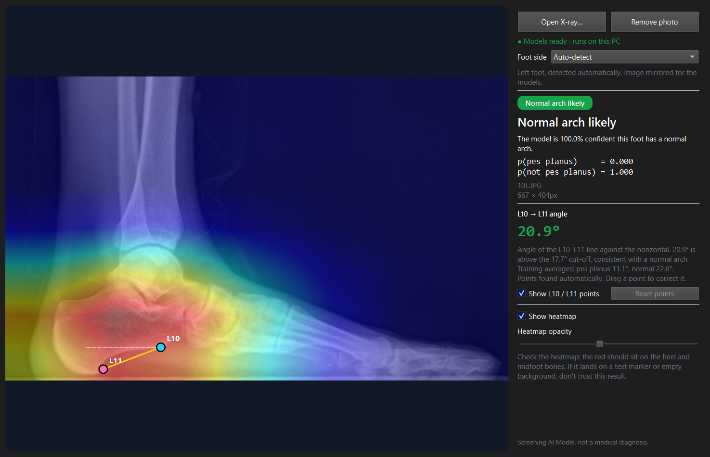

# Flatfoot X-ray Screener

A Windows desktop app that screens lateral foot X-rays for **pes planus (flatfoot)**. Drop in an X-ray and it gives you a verdict, a heatmap of where the model looked, and the **L10→L11 arch angle** measured from two bone landmarks. Everything runs offline on your own PC, with no uploads and no GPU needed.



> ⚠️ **Screening aid, not a medical device.** Results must be reviewed by a clinician.

---

## Features

- **Two independent models**
  - **Classifier**: ResNet-18 that outputs the probability of pes planus, plus a class-activation heatmap.
  - **Landmark model**: ResNet-18 heatmap network that locates landmarks **L10** and **L11** and measures the angle of the line between them against the horizontal.
- **Clear verdicts**: *Pes planus likely*, *Normal arch likely*, or **Borderline** (p between 0.35 and 0.65), which flags the image for review.
- **Explainable**: heatmap overlay with adjustable opacity, to check that the model looked at the heel and midfoot rather than a text marker.
- **Editable landmarks**: drag L10 or L11 to correct them; the angle updates live, and *Reset points* restores the model's positions.
- **Left and right feet**: the foot side is detected automatically, or you can set it yourself (see [How left feet work](#how-left-feet-work)).
- **Flexible input**: open a file, drag and drop, or paste with Ctrl+V. Accepts PNG, JPG, BMP, TIFF and WebP, including **16-bit TIFF** exports and phone photos with **EXIF rotation**.
- **Responsive**: inference runs on a background thread, so the window never freezes, and the display stays sharp on high-DPI screens.

## How it works

```
X-ray ──► normalise (EXIF rotation, 16-bit → 8-bit)
      ──► detect foot side (landmark model on image and its mirror; higher confidence wins)
      ──► mirror left feet so every foot looks like a right foot
      ──► classifier    → p(pes planus) + heatmap
      ──► landmark model → L10, L11 → angle vs. horizontal
      ──► map heatmap and points back onto the original image
```

| Model | Input | Output |
|---|---|---|
| `model.onnx` (classifier) | 1×3×224×224 | `prob`, 7×7 `cam` |
| `landmarks.onnx` | 1×3×256×448 (letterboxed) | 2×64×112 landmark heatmaps |

Angle cut-off: **17.7°**. Below it is consistent with pes planus. Training averages were 11.1° for pes planus and 22.6° for normal. These values live in `landmarks.json`.

### How left feet work

Both models were trained in Google Colab on **right-foot X-rays only** (toes pointing left). A left foot is mirrored before inference, and the heatmap and landmarks are mapped back onto the original image, so you always see results on the X-ray you opened. With *Auto-detect* on, the app runs the landmark model on the image and on its mirror image, and keeps whichever orientation it is more confident about.

## Results

Tested on the Pesplanus Dataset (842 files, 540 unique images), with **4 independent runs**:

| Check | Result |
|---|---|
| Repeatability across 4 runs | **842 / 842 identical**: same probability, verdict, side and angle every time |
| Duplicate copies of the same X-ray | identical results for every copy |
| Classifier vs. dataset folder | **93.0%** of unique images (pes planus 91.0%, normal 98.6%) |
| Angle vs. dataset folder | **93.3%** |
| Foot side detection | **538 / 538** |
| Errors | **0** |

> These images were very likely part of the training data, so the numbers show how well the models learned this dataset, **not** expected accuracy on new patients. Validate on unseen X-rays before relying on them.

## Getting started

### Run the app (Windows)

Download `Flatfoot Screener.exe` from the Releases page and double-click it. It's a single file with both models built in. The first launch takes a few seconds while it unpacks.

### Run from source

Requires Python 3.10 or newer (developed on 3.14).

```bash
git clone <your-repo-url>
cd flatfoot_app
python -m venv .venv
.venv\Scripts\activate
pip install -r requirements.txt
python flatfoot_app.py                 # or: python flatfoot_app.py path\to\xray.jpg
```

`model.onnx`, `landmarks.onnx` and `landmarks.json` must be in the same folder as `flatfoot_app.py`.

### Keyboard shortcuts

| Keys | Action |
|---|---|
| Ctrl+O | Open an X-ray |
| Ctrl+V | Paste an image or file from the clipboard |
| Delete | Remove the current image |

## Tests

```bash
pip install pytest
python -m pytest tests
```

There are 20 tests. They cover 16-bit and EXIF input handling, left/right mirroring (a mirrored right foot must give the identical verdict and angle), side detection with the real models, background analysis and stale-result handling, the heatmap overlay, and high-DPI rendering. The UI tests run headless.

## Build the .exe

```bash
pip install pyinstaller
pyinstaller --noconfirm --onefile --windowed --name "Flatfoot Screener" ^
  --add-data "model.onnx;." --add-data "landmarks.onnx;." --add-data "landmarks.json;." ^
  flatfoot_app.py
```

The executable is written to `dist\Flatfoot Screener.exe` (about 180 MB). It's larger than GitHub's 100 MB file limit, so publish it as a **Release asset** rather than committing it.

## Foot X-ray assistant (doctor accounts and patients)

`foot_assistant.py` is the full clinic app built on the same models: doctor sign-in, patient profiles, and three checks per patient.

```
pip install -r requirements.txt
python foot_assistant.py            # data in %APPDATA%\Foot X-ray Assistant
python foot_assistant.py --data-dir D:\clinic-data
```

**Accounts.** A new doctor account needs a one-time activation key (`FXA-XXXX-XXXX-XXXX-XXXX`). Each key works once per PC. Doctors then sign in with their ID and password (at least 8 characters, letters plus numbers or symbols; stored as PBKDF2-SHA256 hashes). Five wrong passwords lock the account for 60 seconds, and the app signs out after 20 minutes without use. A signed-in doctor can add assistant accounts in Settings: assistants can add patients and X-rays but can't sign off reports.

Make keys with `python tools/make_keys.py 10 --out keys.txt`. Only the keys' SHA-256 hashes go into `assistant/activation_keys.json` (shipped with the app); keep `keys.txt` private and never commit it.

**Patients.** The doctor or assistant creates a patient with the clinic's own Patient ID (unique), name, sex, date of birth, phone and notes. X-rays added to a patient are copied into the data folder, and every result, hand correction, note, flag and sign-off is saved in `assistant.db` (SQLite) on that PC.

**Checks.** Pick the view when adding an X-ray:

| View | Model | What you get |
|---|---|---|
| Side | `model.onnx` + `landmarks.onnx` | Calcaneal pitch (drag L10/L11 to correct), flat foot under 17.7°, high arch flag over 30°, heatmap |
| Side | `heel_finder.onnx` + `heel_spur.onnx` | Spur / normal / child's heel (Sever's) with the heel box and heatmap |
| Top-down | `models/bunion/*.onnx` | HVA and IMA per foot (drag the 6 points to correct) |

Test scores of the app's own pipeline are in `assistant/model_scores.json` and shown in the app; `tools/check_models.py` recomputes them from the datasets.

**Bunion models.** They were trained on HVAngleEst (CC BY-NC-ND 4.0), so the weights are not in this repository. Copy `bunion_points.onnx` (first pass) and `bunion_zoom.onnx` (zoomed pass) into `models/bunion/`, plus `footfinder.onnx` if you have it. Without the foot finder you pick left or right and the whole X-ray is measured as that foot; with it, both feet on one X-ray are found and measured.

**Build the assistant .exe.**

```
pip install pyinstaller
pyinstaller --noconfirm --onedir --windowed --name "Foot X-ray Assistant" ^
  --paths ../ai_models --hidden-import heel_spur.predict --hidden-import bunion.predict ^
  --add-data "model.onnx;." --add-data "landmarks.onnx;." --add-data "landmarks.json;." ^
  --add-data "heel_finder.onnx;." --add-data "heel_spur.onnx;." --add-data "heel_spur.json;." ^
  --add-data "models/bunion;models/bunion" ^
  --add-data "assistant/activation_keys.json;assistant" --add-data "assistant/model_scores.json;assistant" ^
  foot_assistant.py
```

The app is written to `dist\Foot X-ray Assistant\`. Patient data stays in the data folder, not next to the .exe, so a rebuilt app keeps every patient.

## Project structure

```
flatfoot_app/
├── flatfoot_app.py      # the app: preprocessing, inference, UI
├── model.onnx           # pes planus classifier
├── landmarks.onnx       # L10 / L11 landmark model
├── landmarks.json       # landmark names, input size, angle cut-off
├── requirements.txt
├── tests/
│   ├── test_flatfoot_app.py
│   └── data/            # two sample X-rays (left and right foot)
└── docs/
    └── screenshot.png
```

## Notes for the repository

- `landmarks.onnx` (61 MB) is over GitHub's 50 MB warning size. Consider [Git LFS](https://git-lfs.com/) for the `.onnx` files: `git lfs track "*.onnx"`.
- `.gitignore` excludes build output (`dist/`, `build/`), caches and backups.

## Built with

[PySide6](https://doc.qt.io/qtforpython-6/) · [ONNX Runtime](https://onnxruntime.ai/) · [Pillow](https://python-pillow.org/) · [NumPy](https://numpy.org/) · models trained in [Google Colab](https://colab.research.google.com/)

## AI assistance

Parts of this project's code, documentation and repository setup were written with help from [Claude](https://claude.ai) (Anthropic).
